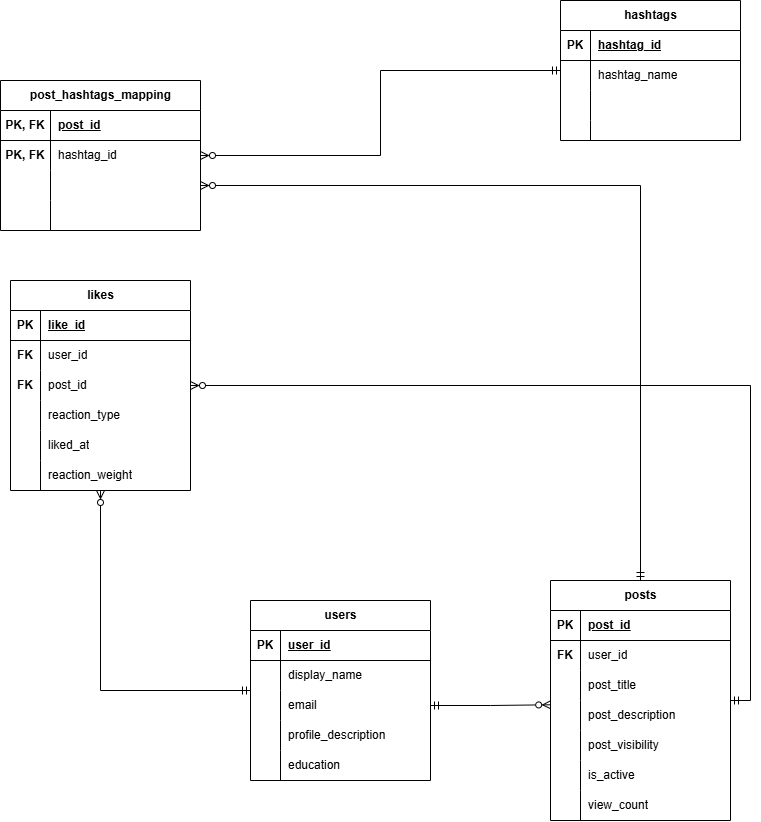

# Social Media Platform — SQL Analytics Portfolio

A PostgreSQL project that analyzes reactions to social media posts, identifies spam-removal failures, compares post activity, and tracks platform performance over time.

**Course:** EX603 — Data and Algorithms for Scalable Systems  
**Database:** PostgreSQL 14+ (analysis verified on PostgreSQL 16)  
**Dataset:** EX603 Unit 3 social media reference dataset, 2023

## 1. The domain and business questions

This project examines a social media/content platform where users react to posts, posts have hashtags and media, and the platform records individual reaction events. The main goal is to understand which posts attract activity, how engagement varies, and where potentially problematic reactions are being removed.

The analysis focuses on a practical question for the platform team: **is the spam-removal failure problem getting better or worse, and what should the team investigate next?** It also examines differences in dwell time, posts with no reaction records, gaps in event activity, and month-to-month changes in volume. The SQL work progresses from relational modeling to joins, aggregations, window functions, and reporting.

## 2. Database overview and ERD



The diagram and [schema/schema.sql](schema/schema.sql) were created for the earlier *Unit 2 modeling exercise*. **Important:** That earlier five-table schema is **not identical** to the supplied Unit 3 reference dataset used for the Unit 4–6 query results. To reproduce the analytics, load the **Unit 3 `social.sql`** file provided in the course. Do not run the Unit 2 schema script over that database.

The Unit 3 reference dataset contains six tables:

| Table | Purpose | Reference rows |
| --- | --- | ---: |
| `users` | User profiles, country, signup, and invitations | 30 |
| `posts` | Post metadata, author country, visibility, and summary metric | 15 |
| `likes` | Individual reaction events, timestamps, dwell time, status, and removal reason | 200 |
| `hashtags` | Hashtag definitions | 5 |
| `post_media` | Media associated with posts | 28 |
| `post_hashtags` | Many-to-many relationship between posts and hashtags | 25 |

The `likes` table drives most of the reporting. A **spam-removal failure** is defined consistently as a row where `reaction_status = 'removed'` and `removal_reason = 'Spam detected'`.

[Unit 2 schema](schema/schema.sql) · [ERD source](schema/erd.drawio) · [Modeling constraints](schema/constraints.md)

## 3. Query catalogue

Each link opens a SQL file containing multiple labelled, independently runnable statements.

| Unit | SQL file | Business question |
| --- | --- | --- |
| 1–2 | [Schema](schema/schema.sql) | How can users, posts, reactions, and hashtags be modeled with keys and constraints? |
| 3 | *Course-provided `social.sql` (not in repository)* | How is the reference dataset created and populated? |
| 4 | [q4_1.sql](queries/unit4/q4_1.sql) | How do dwell time and event volume vary by post and region? |
| 4 | [q4_2.sql](queries/unit4/q4_2.sql) | Where are spam-removal failures concentrated, and what is the baseline rate? |
| 5 | [q5_1.sql](queries/unit5/q5_1.sql) | Which users, posts, and hashtags are associated with events and higher failures? |
| 5 | [q5_2.sql](queries/unit5/q5_2.sql) | Which posts disappear from INNER JOIN reports, and how do outer joins reveal them? |
| 5 | [q5_3.sql](queries/unit5/q5_3.sql) | What do CROSS JOINs and PostgreSQL execution plans show about query behavior? |
| 6 | [q6_1.sql](queries/unit6/q6_1.sql) | How do event averages, rankings, ties, and activity bands compare? |
| 6 | [q6_2.sql](queries/unit6/q6_2.sql) | How does dwell time change between events, how does volume accumulate, and where are gaps? |
| 6 | [q6_3.sql](queries/unit6/q6_3.sql) | What are each post's top three events, and how does event volume change by month? |

**Written reports:** [Unit 4](analysis/unit4.md) · [Unit 4 finding](analysis/unit4-finding.md) · [Unit 5](analysis/unit5.md) · [Unit 5 finding](analysis/unit5-finding.md) · [Unit 6](analysis/unit6.md) · [Unit 6 closing memo](analysis/unit6-finding.md)

## 4. Technical highlights

- **Conditional aggregation:** Counts all reaction events and only spam-removed events in a single query, giving consistent failure rates.
- **Joins and unmatched records:** `LEFT JOIN`, `FULL OUTER JOIN`, `NOT EXISTS`, and `EXCEPT` reveal posts with no recorded reactions that INNER JOIN would omit.
- **CTEs:** Separate calculations from filtering, making rankings, gaps, and multi-step reporting easier to read.
- **Window functions:** `AVG OVER`, `ROW_NUMBER`, `RANK`, `DENSE_RANK`, and `NTILE` show per-event comparisons, ties, and leaderboard bands without losing the original event rows.
- **Time-series functions:** `LAG`, `LEAD`, running `SUM`, moving `AVG`, and a generated month series support adjacent-event and monthly comparisons. `EXPLAIN` in Unit 5 illustrates how PostgreSQL executes joins.

## 5. Findings and recommendations

| Verified finding | Why it matters | Suggested action |
| --- | --- | --- |
| **12 spam-removal failures / 200 events = 6.00%** overall | Establishes a common measure of the issue | Track counts and rates together using the same definition |
| **Quarterly failure rate fell from 7.55% (Q1) to 4.17% (Q4)** | Indicates improvement across 2023, though sample sizes are small | Monitor monthly, especially after December's 12.50% rate |
| **Posts 14 and 15 have no recorded events** | An INNER JOIN hides these posts | Examine visibility, discovery, and event instrumentation |
| **Post 9 had a 112.58-day gap between recorded reactions** | A long gap needs explanation, not a guess about inactivity | Check activity history and logging before treating it as a product failure |

**Main recommendation:** Continue measuring failures by post and month, review moderation cases, investigate posts with missing activity, and avoid drawing strong conclusions from small monthly samples.

See the [Unit 6 closing memo](analysis/unit6-finding.md) for the quarter-by-quarter calculation and proposed next-quarter priorities.

## 6. Limitations and future improvements

The reference dataset has only **200 events from 2023**. It does not establish why an event gap occurred, and its small monthly failure counts make short-term percentage changes sensitive to individual events. A larger dataset plus moderation audit history, tracking-health information, and post-visibility changes would support stronger conclusions.

The `ROWS BETWEEN 6 PRECEDING AND CURRENT ROW` moving average in Unit 6 covers **seven recorded activity dates**, not necessarily seven consecutive calendar days. A full date calendar is needed for a true daily rolling average, including days with zero events.

## 7. How to run the analysis

Requirements: **PostgreSQL 14 or newer**, a terminal with `createdb` and `psql` (or a PostgreSQL GUI such as DataGrip), and access to the **course-provided Unit 3 `social.sql`** file.

The course data file is **not currently committed to this repository**. Obtain it from the Unit 3 assignment materials, then run the following from a terminal where that file is available:

```bash
createdb ex603_data
psql -d ex603_data -f social.sql
psql -d ex603_data -f queries/unit6/q6_1.sql
psql -d ex603_data -f queries/unit6/q6_2.sql
psql -d ex603_data -f queries/unit6/q6_3.sql
```

Use your PostgreSQL instance's actual port with `-p PORT` if it is not 5432. On the tested WSL setup, PostgreSQL ran on port **5433**. If `ex603_data` already exists and contains the course dataset, skip the first two commands. **The reference script drops and recreates tables**, so do not rerun it over a database you need to preserve.

Example verification after loading:

```sql
SELECT COUNT(*) FROM likes; -- expected: 200
SELECT COUNT(*) FROM posts; -- expected: 15
```

In DataGrip, connect to `ex603_data`, open a query file, and execute its individual statements. [Unit 6 SQL](queries/unit6/) is organized by assignment task. Screenshots of executed queries and results belong in [screenshots/](screenshots/).

## 8. Video presentation

A **3–5-minute screen-share video** demonstrating representative SQL queries, their results, key findings, and the recommendation will be linked here **after recording**.

**Status:** Video URL not yet added. The final submission requires both this public GitHub repository URL and an accessible video URL.
